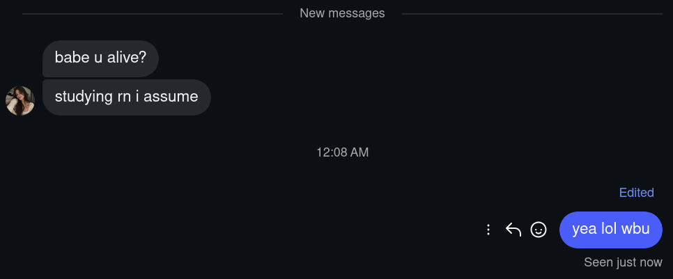

# Claudina

A girl who lives in your Instagram DMs 😭

[](LICENSE) [](https://www.python.org) [](https://ollama.com)

[Features](#features) • [How to use](#how-to-use) • [Requirements](#requirements) • [Setup](#setup) • [Hosting](#hosting) • [Docker](#docker) • [Config](#config) • [Limitations](#limitations) • [Credits](#credits)

---



## Why Claudina
soo uh i couldnt find a girlfriend so i made one 🥀🥀
this project was started during a hackathon october fest and the theme in that hackathon was technology that brings joy and 
my dumbahh though ai gf brings joy so i made this 🥀

## Features
- Lives in her own Instagram account and answers DM's (your girl would never)
- Texts like a real person: short, lowercase, lazy, multiple bubbles
- doesnt respond instantly for realism purposes 🥀
- Reacts with emojis and sometimes just reacts instead of answering
- Double texts ("hellooo??") if you go ded in the middle of a chat
- Ends chats herself ("gtg gn", "ok im sleeping") and then sleeps and doesnt answers (she lives in NYC)
- Texts you first if you haven't talked to her in a while 
- she can watch and send reels and react to them 
- she can post and like stories
- she can send and hear voice notes 

### Relationships
- Everyone starts as a stranger and you have to get closer to her for dating (breaking the ice barrier)
- She can like more than one person (shocker)
- Gets annoyed if you're rude, dry or pushy 
- Leaves people on read if they mess with her

### Memory
- Remembers what you tell her about yourself
- doesn't contradict herself
- Remembers your plans (exam, interview) etc whatever you told her
- Notices when you've been gone 

### Her own life
- Has a weekday and weekend schedule: classes, sleeping, going out
- Doesn't check her phone while she's asleep
- Has her own day and mood, and only brings it up when it fits

### Safety
- Anyone who says they're under 18 gets told they're too young, then ignored bcs she doesnt text minors
- `ADULT_MODE` is off by default, so she keeps everything non explicit but you can turn it on 


## How to use

### What is Claudina

Claudina isn't a girl, it's the code for a girl's brain. You run it on your PC, give it an Instagram account, and it turns that account into a girl who texts people like a normal 20 year old college girl in NYC. Anyone can DM her, and everyone starts out as a stranger. The thinking runs on Groq, which is free you just need to signup !!

### Just wanna try her?

[@claudi.nah](https://instagram.com/claudi.nah) is the Instagram account I run Claudina on. If you don't wanna set anything up, just DM her. Mind you she runs locally on my PC, so she might be down sometimes.

She's the default version: Claudina, 20, a second year psych student in New York who lives in a dorm with her roommate Maya. She's into Frank Ocean, SZA, Gilmore Girls and way too much iced coffee.

### Step 1: Make her an Instagram account

1. Make a new Instagram account for her on your phone. Don't use your own account, she takes it over.
2. Give her a name, a bio and a profile pic. Use an AI made pic or smthin 
3. Don't turn on two factor login, she can't log in .
4. TO let everyone message her, go to **Settings then Messages and story replies then Message controls** and set everyone (followers and others on Instagram) i think its on by default sometimes soo just make sure 
5. Remember the username and password

### Step 2: Get a free Groq API key

1. Go to [console.groq.com](https://console.groq.com) and sign up.
2. Open **API Keys** and click **Create API Key**.
3. Copy the key (it starts with `gsk_`) and save it cuz Groq only shows it once.

### Step 3: Install stuff on your PC

She runs on a PC, not your phone. You need Linux or macOS (on Windows, use WSL), plus

- [Git](https://git-scm.com)
- Python 3.10, 3.11 or 3.12
- [Ollama](https://ollama.com)
- [ffmpeg](https://ffmpeg.org)

### Step 4: Download and start her

Open a terminal and run:

```
git clone https://github.com/Eraxty/Claudina
cd Claudina
./start.sh
```

The first time, it asks you a few things:

1. **groq api key**: paste the key from step 2
2. **her instagram username**: type it without the @
3. **her instagram password**: it won't show while you type, that's normal
4. **her name**: press enter to keep Claudina
5. **her age**: has to be 18 or older, press enter for 20
6. **what she does and where she lives**: like `nurse in Chicago who lives alone with her cat`, press enter to keep the psych student in New York
7. **her timezone**: like `America/Chicago` or `Europe/London`, so she sleeps and wakes up at the right time, press enter for New York
8. **download the local models for explicit chats and pics?**: type n or y you need atleast 20gb storage and a good gpu 

Then it downloads and installs everything, which takes a while the first time. When you see `claudina is up on instagram as @username`, she's online.

### Step 5: Text her

DM her from your own Instagram account. Your first message goes to her message requests and she accepts it herself. She's a stranger at first, so she takes a few minutes to reply, keep talking to her and she gets closer and start dating her smh. 

run `./start.sh` from the `Claudina` folder 

## Requirements

- [Ollama](https://ollama.com), the backup model when Groq is down
- A free Groq API key from [console.groq.com/keys](https://console.groq.com/keys)
- An Instagram account for her

## Setup

```
git clone https://github.com/Eraxty/Claudina
cd Claudina
./start.sh
```

The first run asks for your Groq key and her Instagram login, saves them to `backend/.env`, downloads the models and installs everything. After that, `./start.sh` just starts her.

If you leave the Instagram username empty, you chat with her in the terminal instead.

> Claudina uses [instagrapi](https://github.com/subzeroid/instagrapi), which isn't official. Instagram can flag or ban her account. If that happens she stops and logs tell you to log in on your phone and do what Instagram asks ☹️☹️☹️☹️☹️

## Hosting

She runs on your machine so she's only online while `./start.sh` is running, to keep her up all the time run her on a computer always online or server that stays on, or  inside `tmux` or `screen` so she keeps going after you close the terminal:

```
tmux new -s claudina
./start.sh
```

## Docker

If you'd rather not install Python and Ollama yourself, run her in Docker. You only need [Docker](https://docs.docker.com/get-docker/) installed.

1. Copy the example settings and fill them in (Groq key, her Instagram login, who she is):
   ```
   cp backend/.env.example backend/.env
   ```
2. Start her:
   ```
   docker compose up -d
   ```
   The first time it builds everything and downloads the backup model, which takes a while.
3. Watch what she's doing:
   ```
   docker compose logs -f claudina
   ```
4. Stop her:
   ```
   docker compose down
   ```

Her memories, chats and Instagram login stay in `backend/` on your PC, so nothing is lost when you stop or rebuild her. If Instagram flags her account she stops and stays stopped, so check the logs if she goes quiet.

To chat with her in the terminal instead of Instagram, run `docker compose run --rm claudina python main.py`.

Pics don't work in Docker yet, since the pic model needs an NVIDIA GPU setup. Everything else does.

## Config

Everything goes in `backend/.env`:

| Setting | What it does |
|---|---|
| `GROQ_API_KEY` | Her main brain, plus voice notes and hearing |
| `INSTA_USERNAME` | Her Instagram username. Leave it empty to chat in the terminal |
| `INSTA_PASSWORD` | Her Instagram password |
| `HER_NAME` | Her name, `Claudina` by default |
| `HER_AGE` | Her age, has to be 18 or older, `20` by default |
| `HER_LIFE` | What she does and where she lives, like `nurse in Chicago who lives alone with her cat` |
| `HER_TIMEZONE` | Where her clock is, like `America/Chicago` or `Europe/London`, `America/New_York` by default ([full list](https://en.wikipedia.org/wiki/List_of_tz_database_time_zones)) |
| `ADULT_MODE` | `0` keeps her nonsexual, `1` turns on 18+ chats and pics for confirmed adults she's close to |
| `OLLAMA_MODEL` | Backup model when Groq fails, `gemma3:4b` by default |
| `GROQ_MODEL` | Groq model she uses, `qwen/qwen3.8-27b` by default |

Her personality is the prompt in `respond()` in `backend/main.py`.

## Limitations

- No group chat support yet. If someone adds her to a gc she just ignores it, but DMs still work.
- Her daily schedule is still a college student's (classes, going out), even if you change `HER_LIFE`.
- Her pic face is made once. If you change her age after pics are set up, delete `backend/face.png` so she makes a new one.

## Credits

Built by [Eraxty](https://github.com/Eraxty) 
and [Xorim](https://github.com/Xorim).

## License

[MIT](LICENSE).
